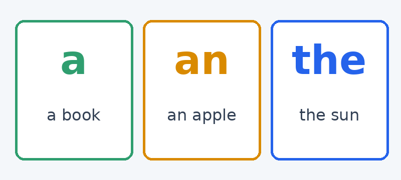

# Grammar basics

A short guide to **articles** and the *simple present*.

## Articles

- **a** before a consonant sound
- **an** before a vowel sound
- **the** for something specific or unique

## Simple present

| Subject | Verb form | Example |
|---|---|---|
| I / you / we / they | base form | They `play` football. |
| he / she / it | base form + s | She `plays` tennis. |

> Tip: say the sentence aloud. If it sounds wrong, check the verb ending.

More reading: [British Council LearnEnglish](https://learnenglish.britishcouncil.org)
